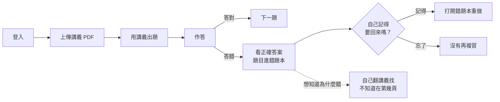
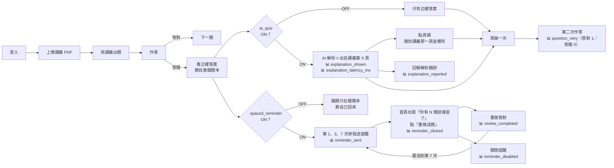
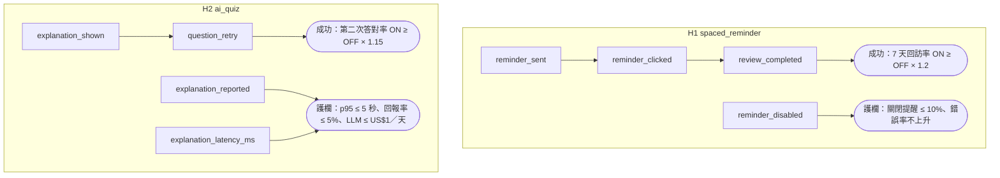

# 改版前後的 user flow（Designer：張）

兩個假設和事件定義在 [`experiment.md`](experiment.md)。
這份文件用流程圖畫出學生從登入到回來複習的每一步，標出兩個 flag 在哪裡分岔、每個事件在哪一步記錄。

## 改版前（兩個 flag 都 OFF）

問題有兩個：

1. 答錯之後只看到答案，不知道錯在哪，要自己翻整份講義。
2. 要不要回來複習全靠自己記得，大部分人就停在「忘了」。

## 改版後（兩個 flag 都 ON）

- 菱形是 flag 的分岔點。兩個 flag 分開分組，所以同一個學生可能 `ai_quiz` ON、`spaced_reminder` OFF。
- 📊 是事件。每個事件都會帶上「這個人當下在哪一組」（on / off / excluded），所以同一個事件可以直接拿 ON 組和 OFF 組來比。
- OFF 那條路就是改版前的產品，沒有拿掉任何東西。

## 每個事件對應到哪個指標

兩個成功指標是用作答紀錄（每次作答都記下當下的分組）直接算的，見 `features.experiment_stats()`；事件是拿來看護欄和漏斗。

`reminder_sent → reminder_clicked → review_completed` 是一個漏斗。如果 H1 沒有成立，可以從這裡看是卡在哪一段：提醒沒送出去、送了沒人點，還是點了沒做完。
