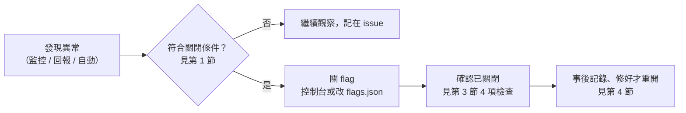

# Kill switch 操作手冊（Operator / QA：賴思穎）

對應 issue #22。設計與完整 rollout 計畫見 [feature-flags.md](feature-flags.md)；這份只講**出事時怎麼關**。
測試：`tests/test_killswitch_scenarios.py`（用真的功能路由演一次「關掉」的流程）。



## 1. 什麼情況要關

| 情況 | 關哪個 | 誰關 |
| --- | --- | --- |
| ON 組錯誤率 ≥ 20%（最近 100 個請求、至少 20 個） | 該 flag | **自動**（`auto:error_rate`），Operator 只需確認 |
| `ai_quiz` 當日 LLM 成本超過預算（預設 1 美元） | `ai_quiz` | **自動**（`auto:llm_budget`） |
| AI 解析 p95 > 5 秒，或「解析錯誤」回報明顯增加 | `ai_quiz` | Operator 賴（備援：PM Juinn） |
| AI 解析內容錯誤、出處頁碼對不上 | `ai_quiz` | Operator 賴 |
| `reminder_disabled`（使用者自己關提醒）> 10%，或提醒重複寄、寄錯人 | `spaced_reminder` | Operator 賴 |
| 安全事件：prompt injection 成功、資料外洩、帳號被盜 | **全部**（一鍵全關） | 任何 admin，不用先問 |

拿不準要不要關的時候就先關。關掉以後使用者只是回到原本的功能（出題、作答、錯題本都還在），不會壞。

## 2. 怎麼關（兩種方式，擇一）

### 方式 A：Admin 控制台（建議，最快）
1. 用 admin 帳號登入，打開 `/admin/flags`。
2. 只關一個：在該 flag 那一列按 **「只關這個 flag」**。
   全部關：在上方「原因」欄位填寫原因（例如「錯誤率暴增」），再按 **「一鍵全關」**。
3. 畫面上方出現「已關閉…，下一個請求生效」就完成了。

### 方式 B：改 `flags.json`（控制台進不去時）
1. 打開 `flags.json`，把該 flag 的 `"enabled": true` 改成 `"enabled": false`，存檔。
2. 不用重啟。下一個請求時程式會發現檔案變了，自動重新讀取。
   log 會出現：`flags reloaded from flags.json: ai_quiz(enabled=False, rollout=...)`
3. 事後補一個 PR，把 `flags.json` 的修改提交進 git，留下紀錄。

> ⚠️ JSON 格式改錯（例如少了逗號）的話，程式會**保留上一份正確設定**，也就是 flag 還開著。
> log 出現 `flags file rejected` 就代表沒有關成功，請修正格式再存一次，或改用方式 A。

## 3. 關完怎麼確認（4 項都要做）

| # | 檢查 | 怎麼做 | 預期 |
| --- | --- | --- | --- |
| 1 | 設定已生效 | 控制台 `/admin/flags` 看狀態；或打開 `flags.json` 看 `enabled` | `enabled=false`，「變更紀錄」最上面有這次的操作（誰、時間、原因） |
| 2 | 實驗組看不到功能 | 用 beta_tester 帳號（例如 Betty）登入，`GET /api/flags`，再打開講義頁 | 該 flag 回 `false`；頁面上沒有 AI 解析／複習提醒區塊 |
| 3 | 直接打 API 會被擋 | 用同一個帳號打 `/api/quizzes/<id>/q/0/explanation`（ai_quiz）或 `/api/reminders`（spaced_reminder） | **403**；控制台的監控裡 `blocked` 次數增加 |
| 4 | 排程提醒不送 | 執行 `flask --app run send-reminders`（admin 也可以 `POST /admin/reminders/run`） | 輸出為 `'sent': 0`，`suppressed` > 0 |

不想手動測試的話，可以直接跑自動測試，會把上面 4 項整套演一次：

```bash
python -m pytest tests/test_killswitch_scenarios.py -v
```

## 4. 關完之後

1. **記錄**：在 GitHub 開 issue（或寫在原本的 issue 底下），記下觸發原因、關閉時間、`updated_by`、影響了多少人（從控制台監控抓數字）。
2. **通知**：在組群組說一聲哪個 flag 關了、為什麼關。如果是 LLM 的問題，要通知林易達。
3. **修好再開**：問題修好、CI 綠燈之後，在控制台把 `enabled` 改回 `true`，並且**填回原本的 rollout**（不要直接開到 100%）。
   重新開啟時，舊的錯誤率紀錄會自動清掉，不會一開就馬上又被自動關掉。
   同一個人會回到原本的分組（分流方式是雜湊），所以實驗數據不會亂掉。
4. **重開後觀察**：前 30 分鐘盯著控制台的錯誤率和延遲，有異常就再關一次。
