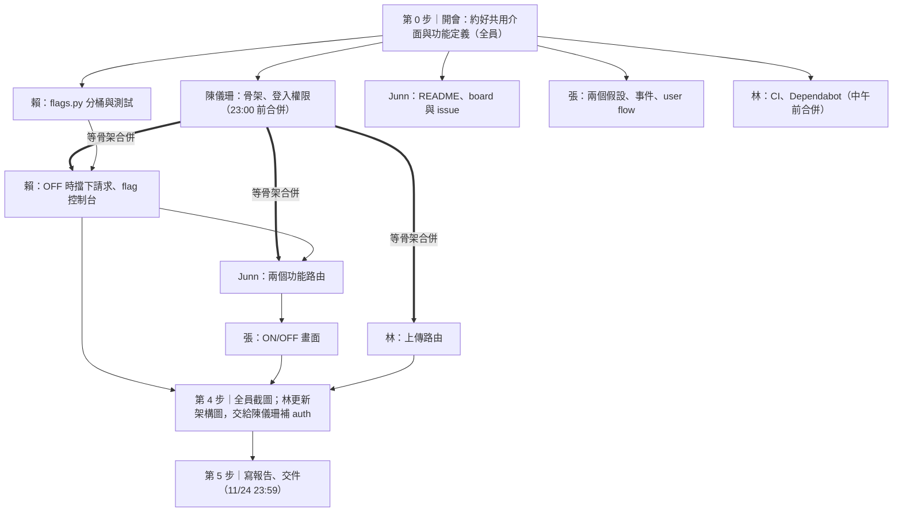

# CourseBuddy 期末專案分工與進度

最新的作業放在最上面；A10 的紀錄保留在後面。

## A11：Pull Request 與 Review（11/24 公布，12/1 前交）

目標：在真的專案上練習 PR review。每人至少負責 1 張 issue、開 1 個 PR、審 1 個組員的 PR，各自交個人報告（沒有團隊報告）。

### 團隊設定

- [x] `main` 的 ruleset `protect-main`（Juinn，11/25）：需要 PR、1 個 approve、`test` 與 `sca` 通過；新 push 讓舊 approve 失效；討論要 resolved；禁止 force push 與刪除。**沒有**勾「Require review from Code Owners」，以免跟下面排好的審核者衝突
- [x] 開 issue #18–#22，指派負責人、加進 Project board（Juinn，11/25）
- [ ] PR 模板 `.github/pull_request_template.md`、`CODEOWNERS`（林易達，#20，請最先合併）
- [x] 約定 review 回覆時間：1 個工作天

### 分工與審查

| 成員 | 角色 | Issue | PR | 審誰的 PR | 被誰審 |
| --- | --- | --- | --- | --- | --- |
| Juinn | PM | [#18](https://github.com/CourseBuddy-AI/CourseBuddy/issues/18) H1/H2 實驗結果判定 | [#24](https://github.com/CourseBuddy-AI/CourseBuddy/pull/24) | 張 | 陳儀珊 |
| 陳儀珊 | Developer A | [#19](https://github.com/CourseBuddy-AI/CourseBuddy/issues/19) `.env.example` 補角色設定、角色權限測試 | [#23](https://github.com/CourseBuddy-AI/CourseBuddy/pull/23) | Juinn | 林易達 |
| 林易達 | Developer B | [#20](https://github.com/CourseBuddy-AI/CourseBuddy/issues/20) PR 模板、CODEOWNERS、每人每日上傳次數限制 | — | 陳儀珊 | 賴思穎 |
| 張 | Designer | [#21](https://github.com/CourseBuddy-AI/CourseBuddy/issues/21) 美化上傳頁與測驗頁、錯誤訊息改成好懂的中文 | — | 賴思穎 | Juinn |
| 賴思穎 | Operator / QA | [#22](https://github.com/CourseBuddy-AI/CourseBuddy/issues/22) kill switch 情境測試、操作步驟寫進 `docs/ops` | — | 林易達 | 張 |

審查順序（箭頭＝審下一位的 PR）：陳儀珊 → Juinn → 張 → 賴思穎 → 林易達 → 陳儀珊

注意：

- Juinn 的統計寫在新檔 `app/analysis.py`，不改賴思穎的 `metrics.py`
- 上傳超過次數的錯誤代碼統一叫 `daily_limit`，林易達與張先對好
- 張的全名、各 PR 連結等開了之後再補進表格

### 時程

| 日期 | 進度 | 狀態 |
| --- | --- | --- |
| 11/25（三） | 設 ruleset、開 issue、開分支 | ✅ |
| 11/26（四） | PR 模板（#20）先合併，之後開 PR 會自動帶入 | |
| 11/26–11/28 | 開 PR、指定審核者 | |
| 11/29–11/30 | 回覆 review、推修正；approve＋CI 通過＋討論 resolved 後合併 | |
| 12/1 前 | 各自上傳 `A11_姓名_角色.pdf` | |

### 開 PR 前

- [ ] 從 `main` 開分支，只改自己負責的檔案
- [ ] 照 PR 模板填：做了什麼與為什麼、`Closes #issue`、怎麼測的、需要特別看的地方
- [ ] 指定審核者；CI 通過

### Review 規則

- 1 個工作天內回覆
- 至少留 1 則具體意見，標明 Blocking／Suggestion／Question／nit；不要只寫 LGTM
- 大家的報告都要截「review 留言＋修正」，請認真留言
- 作者推修正後，審核者要再按一次 approve（ruleset 會讓舊的失效）

### 個人報告（橫式 PDF，`A11_姓名_角色.pdf`）

1. 首頁：組員與角色，自己的名字標出來
2. 自己的 PR 連結、審過的 PR 連結
3. 一段 review 對話截圖（留言＋你的修正）
4. 因為 review 改了什麼
5. 下週要做什麼

報告不能互相複製。12/15 Demo 表現好，週報成績可以升為 E 或 O。

---

## A10 紀錄（11/22–11/24，已繳交）

## 成員與角色

五人各交一份個人報告，**11/24（二）23:59** 前上傳（確切時間以繳交系統為準）。

| 成員 | 角色 | Task | 負責範圍 |
| --- | --- | --- | --- |
| Juinn | PM（組織 owner） | 1 | 成員與角色、責任表、Project board、時程 |
| 陳儀珊 | Developer A | 2 | 登入（Google OIDC）、session、RBAC/ABAC、伺服器端權限檢查 |
| 林 | Developer B | 2 | Dependabot、pip-audit、密鑰管理、PDF 上傳與 LLM 安全、架構圖 |
| 張 | Designer | 3 | 兩個假設、ON/OFF 畫面、user flow |
| 賴 | Operator / QA | 3 | flags.json、rollout、kill switch、監控、測試案例 |

報告格式：6–12 頁、橫式；封面列五人與角色、自己名字標底色；內容為角色與任務、做了什麼（附證據）、和組員的銜接、問題與學習、References。不能內容雷同。

## Repo 現況

改用組織 repo [CourseBuddy-AI/CourseBuddy](https://github.com/CourseBuddy-AI/CourseBuddy)。

新 repo 目前只有 README，程式碼還在舊 repo [yishan2004931022-glitch/coursebuddy](https://github.com/yishan2004931022-glitch/coursebuddy)。

**新 repo 已完成的設定（Developer B，11/22）**

- Dependency graph、Dependabot alerts、Dependabot security updates：開
- Secret Protection（secret scanning）、Push protection：開
- Environment `ci`：已建，無審核者；Secrets 已加 `SECRET_KEY`
- 尚未加：`LLM_API_KEY`、`LLM_MODEL`、`GOOGLE_CLIENT_SECRET`（等拿到 key）

**舊 repo 的內容（commit `1e85f10`）**

| commit | 作者 | 內容 |
| --- | --- | --- |
| `1e85f10` | 陳儀珊 | 合併 PR #4 |
| `2dd5a24` | a7654599 | Developer A 實測腳本 `scripts/devA_probe.sh` |
| `aac274d` | 陳儀珊 | PDF 上傳、LLM 出題、auth/SCA 安全修正、pip-audit 紀錄 |
| `1334923` | CourseBuddy Team | 初始骨架（由 AI 產生）：flag 系統、權限、ON/OFF 畫面、測試、CI |

舊 repo 的 Dependabot alerts 是關的；3 張 Dependabot PR 都是版本更新（actions/checkout 4→7、setup-python 5→7、pytest 9.1.1→9.2.0），不是修漏洞。

## 每個人負責的事

每人寫自己 Task 對應的程式，各開 PR、由另一人審核後合併。

### 共用介面（程式碼的用字每個人都要一樣）

- Python + Flask，資料先放記憶體；flag 名稱 `ai_quiz`、`spaced_reminder`
- 陳儀珊提供：`g.user`（`.id`、`.role`）、`login_required`、`role_required(...)`、`can_view_material(user, material)`
- 賴提供：`is_on(flag, user_id)`、`feature_required(flag)`（OFF 時回 403）
- 只改自己負責的檔案；一律開 PR，另一人審核後才合併

### Juinn｜PM｜Task 1

- [x] 主持開會：確認共用介面與功能定義
- [x] 邀請組員加入組織、設定 repo 權限
- [ ] README：專案目標、兩個實驗功能、成員分工
- [ ] Project board（Todo / In Progress / Review / Done）＋ Due date、Task 欄位＋ Roadmap view
- [ ] labels、Issue 1–5 與開發 issue（每張有負責人與截止日）
- [ ] 程式（11/23 中午）：`features.py`（作答與對錯紀錄、答錯時的 AI 解析＋頁碼、錯題第 1/3/7 天提醒）、兩個功能的路由與測試
- [ ] 11/23 晚上檢查進度；11/24 18:00 收草稿，核對「跟組員的銜接」

### 陳儀珊｜Developer A｜Task 2

- [ ] 程式（**11/22 晚上**，其他人都在等）：`app/__init__.py`、`run.py`、`store.py`、`auth.py`（示範登入、session、角色、CSRF）、登入／首頁／講義頁路由、base／login／dashboard 版型
- [ ] 測試 `test_access.py`：未登入 401、IDOR 403、非 admin 改 flag 403
- [ ] 依實作寫四個決策：登入方式、session 種類、角色與 ABAC、flag OFF 的回應碼
- [ ] 用 curl 實測並截圖；在架構圖紫色框補 auth 部分

### 林｜Developer B｜Task 2

- [x] 開 Dependabot alerts、security updates、Secret scanning、Push protection
- [x] 建 `ci` 環境、加 `SECRET_KEY`
- [x] 安全架構圖底圖（PNG＋.drawio）
- [ ] 程式（**11/22 中午**，不用等人）：`requirements.txt`、`.gitignore`、`.env.example`、`dependabot.yml`、`ci.yml`（pytest、pip-audit、secrets 注入）
- [ ] 程式（11/23 中午）：PDF 上傳檢查（副檔名＋檔頭 `%PDF-`、大小、頁數）、上傳路由、`test_upload.py`
- [ ] 把架構圖交給陳儀珊（11/23 中午前），重寫完後依實作更新
- [ ] 截圖：安全設定頁、Dependabot alerts、CI（test、sca）通過、上傳被擋
- [ ] pip-audit 與高風險套件表（可引用舊 repo Authlib 1.6.5 → 1.9.10 的經驗）；Secret 清單與 CI 注入說明；申請 LLM API key（選廠商、放進 GitHub Secrets、設每日用量上限）

### 張｜Designer｜Task 3

- [ ] 依「功能定義」寫兩個假設（改變、使用者、預期影響、成功指標、防護指標）
- [ ] 事件清單交給賴（賴要在程式裡記錄）
- [ ] 程式（11/23 下午）：`material.html` 兩個功能的 ON/OFF 區塊、`style.css`
- [ ] ON/OFF 對照圖、改版前後 user flow

### 賴｜Operator / QA｜Task 3

- [ ] 程式（11/23 中午）：`flags.json`、`flags.py`（雜湊分桶、熱重載、kill switch）、`feature_required`、`metrics.py`、Admin flag 控制台
- [ ] 測試：`test_flags.py`、TC1–TC7（ON、OFF、切換、伺服器端阻擋），截 CI 結果
- [ ] 兩個 flag 的 ON/OFF 截圖與切換步驟；rollout 計畫與 kill switch 觸發條件

## 先後順序

程式有一條依賴鏈：陳儀珊 → 賴 → Junn → 張。最可能卡住的是陳儀珊的骨架，所以停損點設在她身上；林的 CI 不在這條鏈上，可以馬上開始。

1. **第 0 步｜開會（11/22 上午，全員）**：約好共用介面與功能定義，沒做後面的程式會對不上。
2. **第 1 步｜不用等人，同時開始（11/22）**
   - 陳儀珊：app 骨架、登入、角色權限，**23:00 前合併**
   - 林：CI、Dependabot、requirements，中午前合併
   - 賴：`flags.py` 分桶邏輯與測試（獨立的 Python）
   - 張：兩個假設、事件清單、user flow
   - Junn：README、Project board、開 issue
3. **第 2 步｜等陳儀珊的骨架合併（11/23 中午前）**
   - 賴：`feature_required`、flag 控制台（用她的 `g.user`、`role_required`）
   - 林：上傳路由（用她的 `login_required`）
   - Junn：兩個功能的路由（還要等賴的 `feature_required`）
4. **第 3 步｜等 Junn 的功能（11/23 下午）**：張把 ON/OFF 畫面放進 `material.html`。
5. **第 4 步｜全部合併後（11/23 晚上）**：全員截圖；林依實作更新架構圖，交給陳儀珊補 auth。
6. **第 5 步｜寫報告、交件（11/24）**。

粗箭頭是關鍵依賴：賴、Junn、林的第 2 步都要等陳儀珊的骨架合併；張的畫面又要等 Junn 的功能。

## 功能定義

| 項目 | 決定 | 影響誰 |
| --- | --- | --- |
| 角色 | student / beta_tester / admin，只有 beta_tester 會被分流 | 陳儀珊、賴 |
| flag OFF 打 API | 回 403 | 陳儀珊、賴 |
| Session | Flask 預設簽章 cookie，報告與 JWT、server-side session 比較 | 陳儀珊 |
| 作答 | 出題一直開著；學生作答，系統記錄對錯（錯題本） | Junn |
| ai_quiz | ON：答錯顯示 AI 解析＋講義出處頁碼、「回報解析錯誤」；OFF：答錯只顯示正確答案 | Junn、張、賴、林 |
| spaced_reminder | ON：答錯的題在第 1、3、7 天提醒重做；OFF：錯題只在錯題本 | Junn、張、賴 |
| 事件 | spaced_reminder：reminder_sent、reminder_clicked、review_completed、reminder_disabled；ai_quiz：explanation_shown、question_retry、explanation_reported、explanation_latency_ms | 張、賴 |
| 切換 flag | 熱重載，存檔即生效；提醒發送前再檢查一次 flag | 賴 |
| LLM | 林申請 API key、選廠商；沒有 key 時解析先用示範文字 | 林、Junn |

## 時程與待決事項

| 時間 | 要完成的事 | 負責 |
| --- | --- | --- |
| 11/22 上午 | 開會：共用介面、功能定義；修正 PM 文件、開 issue | 全員／Junn |
| 11/22 中午 | CI、Dependabot、requirements 合併 | 林 |
| 11/22 23:00 | 骨架與登入權限合併（停損點） | 陳儀珊 |
| 11/23 中午 | flag 系統、兩個功能、上傳檢查合併；架構圖交給陳儀珊 | 賴、Junn、林 |
| 11/23 下午 | ON/OFF 畫面合併 | 張 |
| 11/23 20:00 | 截圖與素材放進各自 issue | 全員 |
| 11/24 18:00 | 報告草稿丟群組，核對「跟組員的銜接」 | 全員 |
| 11/24 23:59 | 各自上傳報告 | 全員 |
| 12/15 | Final Demo | 全員 |
